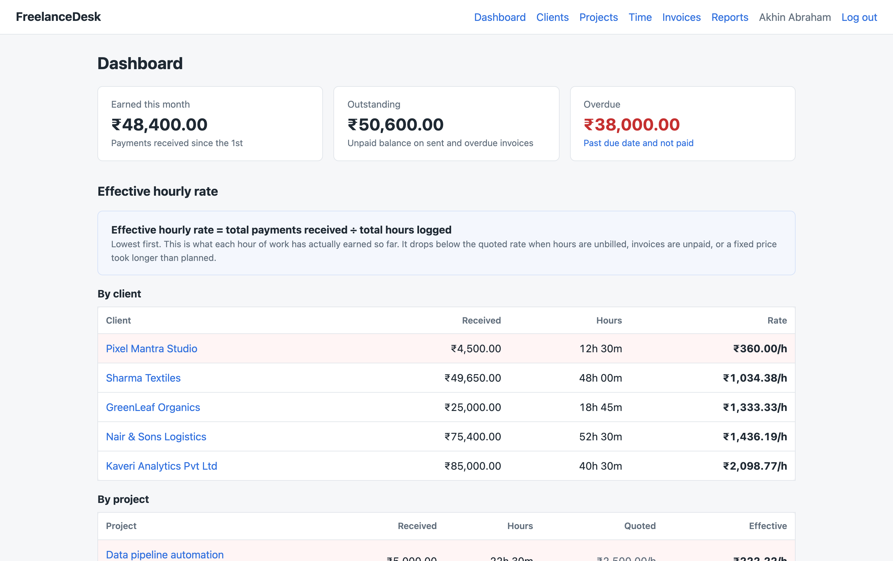
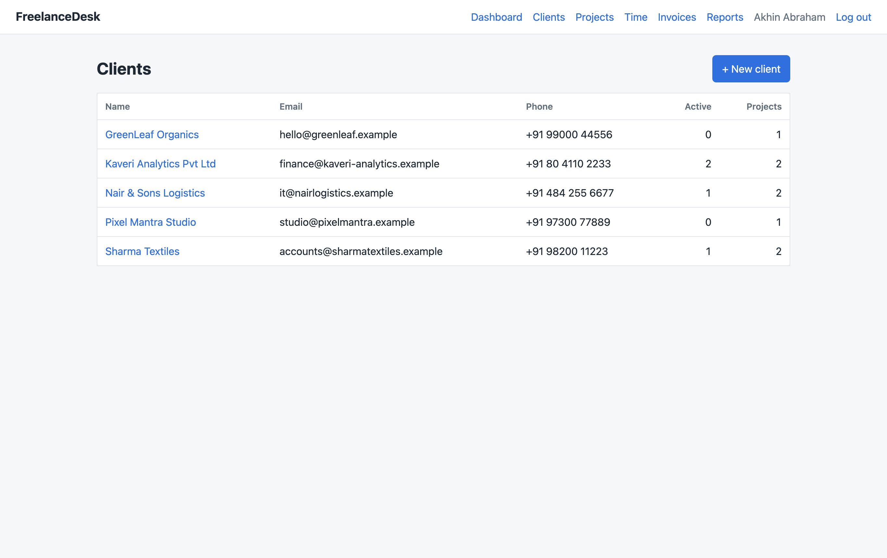
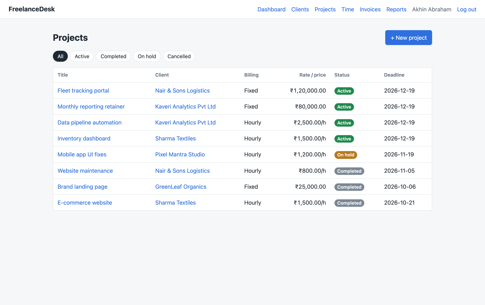
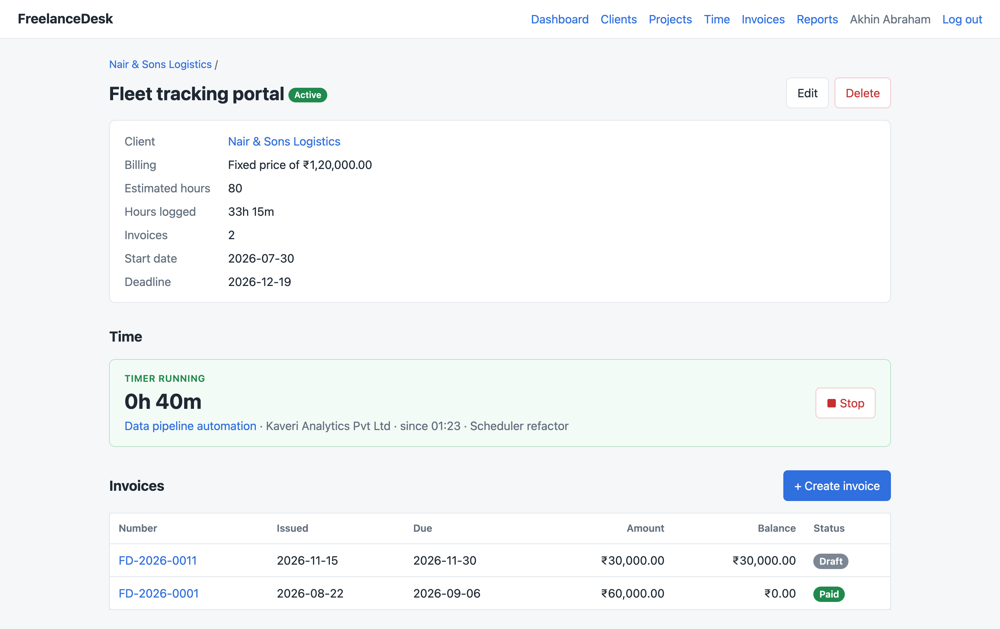
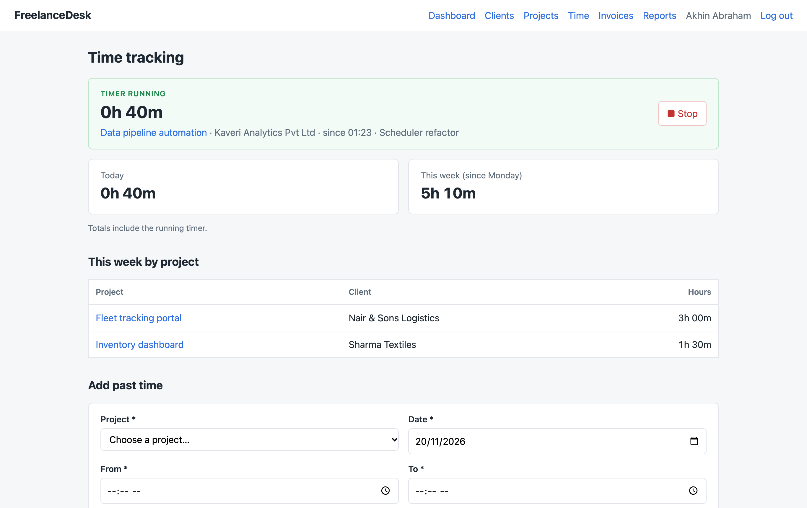
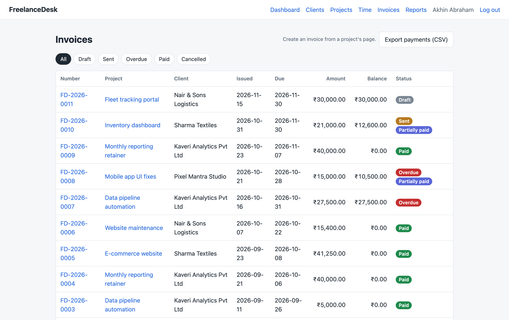
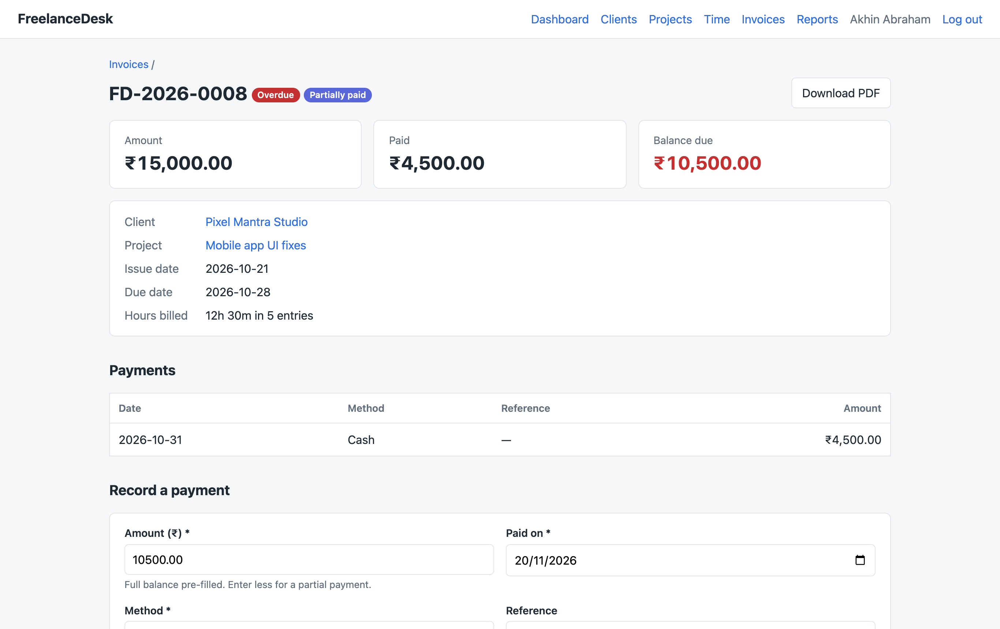
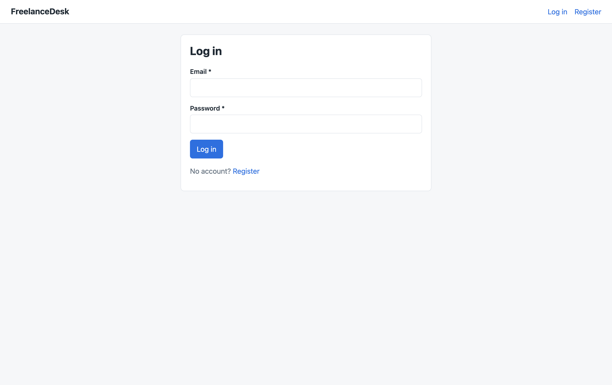
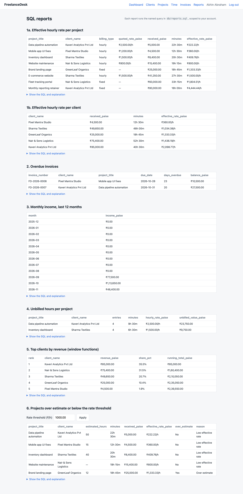
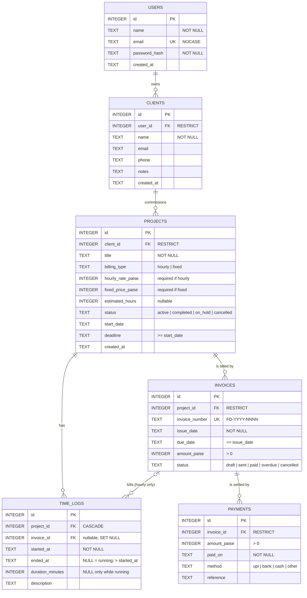

# FreelanceDesk

**A freelance project, time and invoice manager**, built with FastAPI and SQLite, with all the SQL written by hand.

FreelanceDesk helps a freelancer manage clients, projects, working hours, invoices and payments in one web app. Its main feature is the **effective hourly rate**: the money *actually received* divided by the hours *actually worked*, per project and per client. A project quoted at ₹2,500/hour can turn out to earn a few hundred rupees an hour once unbilled hours and unpaid invoices are counted. FreelanceDesk shows this and ranks the clients that pay the least for the time spent on them.

---

## Screenshots

**Dashboard**: this month's earnings, outstanding and overdue amounts, and the effective hourly rate per client and project.



| | |
|---|---|
| **Clients**<br> | **Projects**<br> |
| **Project detail**<br> | **Time tracking**<br> |
| **Invoices**<br> | **Invoice with a partial payment**<br> |
| **Login**<br> | **SQL reports**<br> |

---

## Contents

1. [Features](#1-features)
2. [Tech stack](#2-tech-stack)
3. [Installation](#3-installation)
4. [Running the application](#4-running-the-application)
5. [Using the application](#5-using-the-application)
6. [System architecture](#6-system-architecture)
7. [Project structure](#7-project-structure)
8. [Database design](#8-database-design)
9. [The effective hourly rate](#9-the-effective-hourly-rate)
10. [SQL reports](#10-sql-reports)
11. [Business rules](#11-business-rules)
12. [Security](#12-security)
13. [Testing](#13-testing)
14. [Running the SQL yourself](#14-running-the-sql-yourself)
15. [URL reference](#15-url-reference)
16. [Troubleshooting](#16-troubleshooting)
17. [Author and license](#17-author-and-license)

---

## 1. Features

| Module | What it does |
|---|---|
| **Accounts** | Register, log in and log out. Passwords are hashed with salted PBKDF2-SHA256. The session cookie is signed. Every user sees only their own data. |
| **Clients** | Add, view, edit and delete clients (name, email, phone, notes). A client that still has projects cannot be deleted; a clear message explains why. |
| **Projects** | Projects are billed **hourly** (with a rate) or at a **fixed price**. Each has a status (active, completed, on hold, cancelled), an optional estimate in hours, a start date and a deadline. |
| **Time tracking** | A start/stop **timer**, and manual entry of past time. Only **one timer can run per user**, and the database enforces this with triggers. Shows hours **today** and **this week**, and this week's hours per project. |
| **Invoices** | Created from a project. For hourly projects the amount is **pre-filled from unbilled hours × rate**, and those hours are marked as billed. Numbers look like `FD-2026-0001` and are generated safely inside a transaction. Each invoice can be **downloaded as a PDF**. |
| **Payments** | Record **full or partial** payments (UPI, bank transfer, cash, other). The invoice changes to **paid** automatically once it is fully covered, and to **overdue** once it is past its due date. Paying more than the balance is rejected. |
| **Dashboard** | Earned this month, the outstanding amount and the overdue amount. The **effective hourly rate per project and per client**, lowest first. Bar charts of **income by month** and **hours by client**. |
| **Reports** | Six SQL reports, each shown with its result table, the exact SQL and an explanation. |
| **CSV export** | Download **payments** and **time logs** as CSV files for Excel or Google Sheets. |

---

## 2. Tech stack

| Layer | Technology | Version | Why it was chosen |
|---|---|---|---|
| Language | Python | 3.11+ | Required by the course; type hints and a modern standard library |
| Web framework | [FastAPI](https://fastapi.tiangolo.com/) | 0.165.0 | Clean routing, built-in dependency injection (database connection, current user) |
| ASGI server | Uvicorn | 0.54.0 | Runs the FastAPI app; `--reload` restarts it on code changes |
| Templates | Jinja2 | 3.1.6 | Pages are rendered on the server, so no JavaScript framework or build step is needed |
| Forms | python-multipart | 0.0.34 | Parses HTML form submissions |
| Sessions | Starlette `SessionMiddleware` + itsdangerous | 2.2.0 | Signed login cookie that cannot be edited |
| Database | **SQLite**, using Python's built-in `sqlite3` module | bundled | No server to install. All SQL is written by hand with `?` placeholders, **with no ORM**, so every query is visible |
| PDF | fpdf2 | 2.9.0 | Generates invoice PDFs in pure Python |
| Charts | Chart.js (from a CDN) | 4.4.1 | Two bar charts on the dashboard; no build step |
| Styling | Plain CSS | — | One stylesheet, responsive down to phone width |
| Testing | pytest + httpx | 9.2.0 / 0.28.1 | Unit tests and full web-request tests with FastAPI's `TestClient` |

Every dependency is pinned in [`requirements.txt`](requirements.txt).

---

## 3. Installation

### Prerequisites

- **Python 3.11 or newer.** Check with `python3 --version` (on Windows, `python --version`).
- **Git** (optional; you can also download the repository as a ZIP from GitHub).
- An internet connection the first time, to install packages. The dashboard charts also load Chart.js from a CDN.

### Step 1: Get the code

```bash
git clone https://github.com/theakhinabraham/freelance-desk.git
cd freelance-desk
```

### Step 2: Create and activate a virtual environment

A virtual environment keeps this project's packages separate from the rest of your system.

**macOS / Linux**
```bash
python3 -m venv .venv
source .venv/bin/activate
```

**Windows (PowerShell)**
```powershell
python -m venv .venv
.venv\Scripts\Activate.ps1
```

**Windows (Command Prompt)**
```bat
python -m venv .venv
.venv\Scripts\activate.bat
```

When it is active, your prompt starts with `(.venv)`.

### Step 3: Install the dependencies

```bash
pip install -r requirements.txt
```

### Step 4: Load the demo data (recommended)

```bash
python -m db.seed
```

This creates `freelancedesk.db` with realistic sample data:

| Clients | Projects | Time logs | Invoices | Payments |
|---|---|---|---|---|
| 5 | 8 | 70+ | 11 | 11 (including partial payments) |

All dates are relative to today, so the dashboard always shows current data.

> ⚠️ `python -m db.seed` **deletes** the existing database and creates a new one. Run it again whenever you want a fresh demo.

---

## 4. Running the application

```bash
uvicorn app.main:app --reload
```

Open **http://127.0.0.1:8000** in your browser and log in with the demo account:

| Email | Password |
|---|---|
| `akhin@gmail.com` | `demo1234` |

You can also register a new account. The tables are created automatically on startup, so the app works with an empty database too.

Press **Ctrl + C** in the terminal to stop the server.

### Configuration (optional)

| Environment variable | Default | Purpose |
|---|---|---|
| `FREELANCEDESK_SECRET` | `dev-only-secret-change-me` | Key that signs the session cookie. Set a long random value in any real deployment. |
| `FREELANCEDESK_DB` | `./freelancedesk.db` | Path to the SQLite database file |

Example: `FREELANCEDESK_SECRET="$(python -c 'import secrets; print(secrets.token_hex(32))')" uvicorn app.main:app`

---

## 5. Using the application

A typical flow with the demo data:

1. **Dashboard:** see this month's earnings, outstanding and overdue amounts, and which client has the lowest effective hourly rate.
2. **Clients → Projects:** open a client and its projects. Try deleting a client that has projects; it is blocked with an explanation.
3. **Time:** start the timer on a project, then try starting another one. The second start is refused (one running timer per user). Stop the timer, or add past time manually.
4. **Project page → New invoice:** for an hourly project, the amount is pre-filled from the unbilled hours. Create it, mark it as sent and download the PDF.
5. **Invoice page → Record payment:** record a partial payment (the status stays *sent*), then pay the rest (the status changes to *paid*).
6. **Reports:** see each SQL report with its result, its SQL and an explanation. Change the rate threshold for report 6.
7. **Export:** download payments (Invoices page) or time logs (Time page) as CSV.
8. **`/health`:** a diagnostic page with row counts per table that confirms foreign keys are on.

---

## 6. System architecture

FreelanceDesk uses a **layered architecture**. Each layer has one job and calls only the layer below it.

```
┌──────────────────────────────────────────────────────────────────┐
│  Browser:  HTML pages, plain CSS, Chart.js (dashboard only)      │
└───────────────────────────────┬──────────────────────────────────┘
                                │  HTTP (forms, links, signed session cookie)
┌───────────────────────────────▼──────────────────────────────────┐
│  PRESENTATION   app/templates/*.html  ·  app/templating.py       │
│                 Jinja2 pages; ₹ and hours formatted only here    │
├──────────────────────────────────────────────────────────────────┤
│  ROUTING        app/routers/*.py  ·  app/auth.py  ·  app/forms.py│
│                 Login check, form validation, redirects, files   │
├──────────────────────────────────────────────────────────────────┤
│  SERVICES       app/services/*.py  ·  app/reports.py             │
│                 Business rules + all SQL (parameterized),        │
│                 transactions for multi-table changes             │
├──────────────────────────────────────────────────────────────────┤
│  DATA           app/db.py  ·  db/schema.sql  ·  db/reports.sql   │
│                 SQLite: tables, CHECKs, FKs, triggers, indexes   │
└──────────────────────────────────────────────────────────────────┘
```

### What happens when you open the dashboard

1. The browser sends `GET /dashboard` with the signed session cookie.
2. `SessionMiddleware` checks the cookie's signature and reads `user_id`. The `current_user` dependency loads the user, or redirects to `/login`.
3. The `db.get_db` dependency opens **one SQLite connection for this request** and runs `PRAGMA foreign_keys = ON`.
4. The dashboard service first runs `refresh_overdue()`, which marks unpaid invoices past their due date as overdue. It then runs the named queries from `db/reports.sql`, always passing the user's id as `?1`.
5. The router passes the rows to `dashboard.html`, which formats paise as ₹ and draws the charts.
6. The response is sent, and the connection is closed.

### Key design decisions

- **No ORM.** Every query is plain, readable SQL, so the database work is visible.
- **The report SQL lives in one file** ([`db/reports.sql`](db/reports.sql)). The app loads each query by name, so the SQL you read is exactly what runs.
- **Money is stored as integer paise**, never as floats, and is formatted only when it is displayed.
- **No background workers.** The *overdue* status is refreshed by one indexed `UPDATE` before the relevant pages are shown.

---

## 7. Project structure

```
freelance-desk/
├── app/
│   ├── main.py              # FastAPI app: middleware, routers, error pages, /health
│   ├── db.py                # connect() with PRAGMA foreign_keys, transaction(), IST time helpers
│   ├── auth.py              # PBKDF2 password hashing, register / login / logout, current_user
│   ├── forms.py             # form validation; "1,500.50" → 150050 paise
│   ├── templating.py        # Jinja2 setup, ₹ (Indian digit grouping) and hours filters, flash messages
│   ├── reports.py           # loads the named queries from db/reports.sql
│   ├── routers/             # HTTP layer, one file per area
│   │   ├── clients.py  projects.py  time.py
│   │   ├── invoices.py      # invoices + recording payments + PDF download
│   │   ├── dashboard.py     # dashboard and reports page
│   │   └── exports.py       # CSV downloads
│   ├── services/            # business logic and SQL, one file per area
│   │   ├── clients.py  projects.py  time_logs.py
│   │   ├── invoices.py  payments.py  dashboard.py
│   │   ├── pdf.py           # invoice PDF (fpdf2)
│   │   └── exports.py       # CSV building
│   ├── templates/           # Jinja2 HTML pages
│   └── static/style.css
├── db/
│   ├── schema.sql           # tables, constraints, indexes, triggers, each with a comment
│   ├── reports.sql          # the 6 required reports + dashboard totals, as named queries
│   └── seed.py              # demo data generator
├── tests/                   # 129 pytest tests
├── requirements.txt
├── pytest.ini
└── LICENSE
```

---

## 8. Database design

### Entity-relationship diagram



### Tables

| Table | Purpose | Key columns |
|---|---|---|
| `users` | One row per freelancer account | `email` UNIQUE (case-insensitive), `password_hash` |
| `clients` | A user's clients | `user_id` → users |
| `projects` | Work for a client, hourly or fixed price | `client_id` → clients, `billing_type`, `hourly_rate_paise`, `fixed_price_paise`, `estimated_hours`, `status` |
| `time_logs` | Time worked on a project | `project_id` → projects, `invoice_id` → invoices (NULL = unbilled), `ended_at` (NULL = timer running), `duration_minutes` |
| `invoices` | A bill for a project | `invoice_number` UNIQUE, `issue_date`, `due_date`, `amount_paise`, `status` |
| `payments` | Money received against an invoice (several per invoice) | `invoice_id` → invoices, `amount_paise`, `paid_on`, `method` |

### Relationships and delete rules

| Parent → child | Cardinality | On delete | Reason |
|---|---|---|---|
| users → clients | 1 : N | RESTRICT | Every client belongs to exactly one user; this is how users' data is kept apart |
| clients → projects | 1 : N | RESTRICT | A client with projects cannot be deleted |
| projects → time_logs | 1 : N | CASCADE | A time log means nothing without its project |
| projects → invoices | 1 : N | RESTRICT | Financial records must never disappear |
| invoices → time_logs | 0..1 : N | SET NULL | If an invoice row is deleted, its hours become unbilled instead of disappearing |
| invoices → payments | 1 : N | RESTRICT | Payments are permanent financial records |

### Rules enforced by the database

| Mechanism | Rule |
|---|---|
| `CHECK` | Allowed values for `billing_type`, `status` and `method`; an hourly project must have a rate and a fixed project a price; `ended_at > started_at`; a finished log must have a duration; amounts `> 0`; `due_date >= issue_date`; `deadline >= start_date`; invoice numbers must match `FD-[0-9]{4}-[0-9]{4}` (via `GLOB`) |
| `UNIQUE` | `users.email` (with `COLLATE NOCASE`) and `invoices.invoice_number` |
| `FOREIGN KEY` | Every child row must point to an existing parent. Enforced because every connection runs `PRAGMA foreign_keys = ON` (SQLite turns this off by default) |
| **Triggers** | `trg_one_running_timer_insert` / `_update` allow **at most one running timer per user**. A UNIQUE index can't express this rule, because the owning user is two joins away from `time_logs` |

### Indexes

| Index | Columns | Speeds up |
|---|---|---|
| `idx_clients_user` | `clients(user_id)` | "My clients" on every page (SQLite does not index foreign keys automatically) |
| `idx_projects_client` | `projects(client_id)` | Client → project joins |
| `idx_invoices_project` | `invoices(project_id)` | A project's invoices |
| `idx_invoices_status_due` | `invoices(status, due_date)` | **Composite:** `WHERE status = 'sent' AND due_date < ?`, the overdue check (equality column first, range column second) |
| `idx_time_logs_project` | `time_logs(project_id)` | Hours per project |
| `idx_time_logs_invoice` | `time_logs(invoice_id)` | The logs billed on an invoice, and the `SET NULL` action |
| `idx_time_logs_started` | `time_logs(started_at)` | Today / this week totals |
| `idx_time_logs_running` | `time_logs(project_id) WHERE ended_at IS NULL` | **Partial index:** holds only running timers, so it stays tiny |
| `idx_payments_invoice` | `payments(invoice_id)` | Amount paid and balance per invoice |
| `idx_payments_paid_on` | `payments(paid_on)` | Earned this month, income by month |

### Normalization (3NF)

- **1NF:** every column holds one atomic value. Repeating data, such as several time entries or several payments for one invoice, goes into separate rows of its own table.
- **2NF:** every table has a single-column primary key, so no column can depend on only *part* of a key.
- **3NF:** no non-key column depends on another non-key column. For example, `time_logs` has **no `user_id`**; the owner is reached through `project → client → user`. Derived values (amount paid, balance, effective rate) are **calculated by queries, not stored**, so they can never disagree with the data they come from.
- **Deliberate choices:** `duration_minutes` is stored (SQLite has no interval type), and a CHECK keeps it consistent with `ended_at`. The `paid` and `overdue` statuses are stored because the requirements define them as invoice statuses; they are updated in the same transaction as the payment, or by one indexed `UPDATE`.

### Conventions

- **Money:** `INTEGER` paise (₹1 = 100 paise). Floats can't store values like 0.10 exactly; integers are exact.
- **Dates and times:** ISO-8601 text (`YYYY-MM-DD`, `YYYY-MM-DD HH:MM:SS`) in Indian Standard Time. ISO strings sort chronologically, so `<` and `>` comparisons work.

---

## 9. The effective hourly rate

```
effective hourly rate = total payments received ÷ total hours logged
```

It is calculated per **project** and per **client**, and listed **lowest first**, so the projects and clients that pay worst for the time spent appear at the top.

In SQL, a project has *many* payments and *many* time logs. Joining both directly would pair every payment with every log (3 payments × 10 logs = 30 rows) and inflate both totals. This is known as the **fan-out problem**. So each side is added up separately in a CTE first, and the two totals are then joined:

```sql
WITH received AS (                      -- total paid per project
    SELECT i.project_id, SUM(pay.amount_paise) AS received_paise
    FROM payments pay JOIN invoices i ON i.id = pay.invoice_id
    GROUP BY i.project_id
),
logged AS (                             -- total minutes per project
    SELECT project_id, SUM(duration_minutes) AS minutes
    FROM time_logs WHERE ended_at IS NOT NULL
    GROUP BY project_id
)
SELECT p.title,
       (COALESCE(r.received_paise, 0) * 60 + l.minutes / 2)
           / NULLIF(l.minutes, 0) AS effective_rate_paise   -- paise per hour, rounded
FROM projects p
JOIN clients c       ON c.id = p.client_id
LEFT JOIN received r ON r.project_id = p.id
LEFT JOIN logged   l ON l.project_id = p.id
WHERE c.user_id = ?1
ORDER BY effective_rate_paise IS NULL, effective_rate_paise;
```

`NULLIF(..., 0)` avoids dividing by zero for projects with no hours. Adding `minutes / 2` rounds to the nearest paisa using only integer arithmetic.

---

## 10. SQL reports

All reports are in [`db/reports.sql`](db/reports.sql) as **named, commented queries**. You can see them on the **Reports** page of the app.

| # | Report | SQL techniques |
|---|---|---|
| 1 | Effective hourly rate per project and per client | CTEs (`WITH`), `LEFT JOIN`, `GROUP BY`, `COALESCE`, `NULLIF` |
| 2 | Overdue invoices with days overdue | Multi-table `JOIN`, **correlated subquery** for the balance, `julianday()` date arithmetic |
| 3 | Monthly income for the last 12 months (months with no income show ₹0) | **Recursive CTE** to generate the months, `LEFT JOIN`, `GROUP BY` |
| 4 | Unbilled hours per project and their value | `JOIN`, `WHERE` vs **`HAVING`** |
| 5 | Top clients by revenue with share of total and running total | **Window functions**: `RANK() OVER`, `SUM() OVER ()`, `SUM() OVER (ORDER BY … ROWS UNBOUNDED PRECEDING)` |
| 6 | Projects over their estimate **or** below a rate threshold | Chained CTEs, scalar subquery, `GROUP BY` / `HAVING`, `CASE` |
| — | Dashboard totals (earned this month, outstanding, overdue) | Derived table, **conditional aggregation** `SUM(CASE WHEN …)` |

---

## 11. Business rules

| Rule | How it is implemented |
|---|---|
| **One running timer per user** | Database triggers that `RAISE(ABORT)`, plus a friendly message in the app |
| **Safe invoice numbers** (`FD-YYYY-NNNN`) | `SELECT MAX(CAST(substr(invoice_number, 9) AS INTEGER))` for the year + 1, inside `BEGIN IMMEDIATE`, so two requests cannot get the same number. A `UNIQUE` constraint is a second safeguard |
| **Invoice pre-fill** | Hourly: unbilled minutes × rate (rounded to the paisa). Fixed: the price minus what has already been invoiced |
| **Creating an invoice** | One transaction: insert the invoice **and** mark its time logs as billed. If either step fails, nothing is saved |
| **Partial payments** | A partly paid invoice stays *sent* or *overdue*. When `SUM(payments) >= amount`, an `UPDATE` with a subquery sets it to *paid*, in the same transaction as the payment |
| **No overpayment** | The balance is checked inside the same `BEGIN IMMEDIATE` transaction as the insert |
| **Overdue** | `UPDATE invoices SET status = 'overdue' WHERE status = 'sent' AND due_date < today`, run before invoice pages and the dashboard; uses the composite index |
| **Cancelling an invoice** | Allowed only while no payment has been recorded; its hours become unbilled again in the same transaction |

---

## 12. Security

| Threat | Protection |
|---|---|
| SQL injection | **Every** query uses `?` placeholders; values are never put into SQL strings |
| Password theft | PBKDF2-HMAC-SHA256, 600,000 iterations, random 16-byte salt per user; constant-time comparison (`hmac.compare_digest`) |
| Finding out which emails are registered | Login runs a full hash even for unknown emails and shows the same error either way |
| Editing the session cookie | The cookie holds only `user_id` and is **signed** by `SessionMiddleware`; a changed cookie is rejected |
| Cross-site request forgery | Session cookie set with `SameSite=Lax`; every action that changes data uses POST |
| Seeing another user's data | Every query is scoped with `clients.user_id = ?`; another user's record returns **404**, exactly like a missing one |
| Open redirects | Redirect targets are built from numeric ids only, never from user-supplied URLs |
| CSV formula injection | Cells starting with `=`, `+`, `-` or `@` are escaped in exports |
| Half-finished changes | Changes that touch several tables run in one transaction (`BEGIN IMMEDIATE … COMMIT`, with `ROLLBACK` on error) |

---

## 13. Testing

```bash
pytest          # runs all 129 tests in about a second
pytest -v       # shows each test by name
```

Each test runs against a **brand-new in-memory or temporary-file database**, so the tests never touch `freelancedesk.db`.

| Test file | Covers |
|---|---|
| `test_schema.py` | `PRAGMA foreign_keys`, every CHECK constraint, foreign keys, the one-running-timer triggers |
| `test_foundation.py` | Transaction rollback, invoice numbering, ₹ and hours formatting, demo data, health page |
| `test_auth.py` | Password hashing, registration, login, logout, a tampered session cookie |
| `test_clients_projects.py` | CRUD, blocked client delete, money stored as exact paise, validation |
| `test_time.py` | Timer start/stop, one running timer per user, manual entry, today/week totals |
| `test_invoices.py` | Pre-filled amounts, partial → paid, overpayment, overdue, cancelling, PDF, full web flow |
| `test_dashboard.py` | **Effective hourly rate**, dashboard totals, every query in `reports.sql` |
| `test_isolation.py` | **User data isolation**: user B can never see or change user A's data |
| `test_exports.py` | CSV contents, formula escaping, login requirement, per-user data |

---

## 14. Running the SQL yourself

Every report can be run directly in the SQLite shell. `?1` is the user id and `?2` is a date or a threshold:

```text
sqlite3 freelancedesk.db
sqlite> .mode box
sqlite> .parameter set ?1 1
sqlite> .parameter set ?2 '2026-11-20'
sqlite> -- paste any query from db/reports.sql
```

Other useful shell commands: `.tables`, `.schema invoices`, and `EXPLAIN QUERY PLAN <query>` (shows which index a query uses).

---

## 15. URL reference

| Method | URL | Purpose |
|---|---|---|
| GET / POST | `/register`, `/login` | Create an account / log in |
| POST | `/logout` | Log out |
| GET | `/dashboard` | Totals, effective rates, charts |
| GET | `/reports` | The SQL reports (`?threshold=` sets the rate for report 6) |
| GET / POST | `/clients`, `/clients/new`, `/clients/{id}`, `/clients/{id}/edit`, `/clients/{id}/delete` | Clients |
| GET / POST | `/projects`, `/projects/new`, `/projects/{id}`, `/projects/{id}/edit`, `/projects/{id}/delete` | Projects |
| GET / POST | `/time`, `/time/start`, `/time/stop`, `/time/manual`, `/time/{id}/delete` | Time tracking |
| GET / POST | `/invoices`, `/invoices/new`, `/invoices/{id}`, `/invoices/{id}/send`, `/invoices/{id}/cancel` | Invoices |
| POST | `/invoices/{id}/payments` | Record a payment |
| GET | `/invoices/{id}/pdf` | Download the invoice PDF |
| GET | `/export/payments.csv`, `/export/time_logs.csv` | CSV export |
| GET | `/health` | Diagnostic page (row counts, foreign keys on) |

---

## 16. Troubleshooting

| Problem | Fix |
|---|---|
| `uvicorn: command not found` / `No module named fastapi` | The virtual environment isn't active. Run `source .venv/bin/activate` (Windows: `.venv\Scripts\activate`) |
| `Address already in use` | Port 8000 is taken: `uvicorn app.main:app --reload --port 8001` |
| PowerShell won't run `Activate.ps1` | Run `Set-ExecutionPolicy -Scope CurrentUser RemoteSigned` once, or use Command Prompt |
| Charts don't appear | Chart.js loads from a CDN, so check your internet connection. Everything else works offline |
| Login fails with the demo account | Run `python -m db.seed` to recreate it |
| Want a clean start | Stop the server, then run `python -m db.seed` (or delete `freelancedesk.db` for an empty database) |

---

## 17. Author and license

**Akhin Abraham**, MCA mini project (Python).

Released under the [MIT License](LICENSE).
